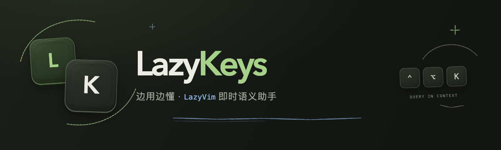
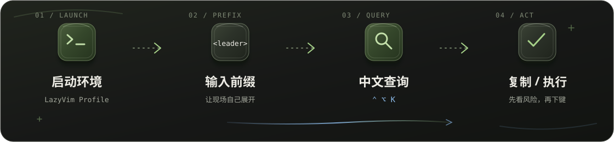

<p align="center">
  
</p>

# LazyKeys

**边用边懂 LazyVim：在 Neovim 旁边，用中文解释你现在该按什么。**

LazyKeys 是一个轻量的 macOS 桌面助手。它读取受管 Neovim 会话的当前模式、未完成按键和页面状态，通过不抢焦点的浮窗给出下一步提示；也可以搜索命令、复制按键，或在确认后执行到当前编辑器。

_Learn LazyVim in context: Chinese command search, a non-intrusive overlay, and isolated Neovim profiles._

[](https://github.com/12bitsD/lazykeys/actions/workflows/ci.yml)
[](https://github.com/12bitsD/lazykeys/releases/latest)
[](https://github.com/12bitsD/lazykeys/releases/latest)
[](LICENSE)

## 下载

 前往 **[最新 Release](https://github.com/12bitsD/lazykeys/releases/latest)**，选择适合你使用方式的包：

- **`LazyKeys_<version>_arm64.dmg`**：推荐。打开后将 LazyKeys 拖入“应用程序”。
- **`LazyKeys_<version>_arm64.app.zip`**：直接 App 包。解压后将 `LazyKeys.app` 移入“应用程序”。
- **`SHA256SUMS.txt`**：两个安装包的 SHA-256 校验值。

当前版本支持 **macOS Apple Silicon（M1 及更新机型，arm64）**，暂不提供 Intel 构建。Release 尚未进行 Apple Developer ID 签名和公证；首次打开如果提示无法验证开发者，请确认下载来源是本仓库后，在 Finder 中右键 App 选择“打开”。无需关闭系统安全保护。

## 主要功能

<table>
  <tr>
    <td width="50%"> <strong>看懂当前操作现场</strong><br>跟随 Neovim 模式、未完成前缀和插件页面，显示下一步、退出方式与分段助记；无会话时自动隐藏，可拖动、关闭，也支持置顶和鼠标穿透。</td>
    <td width="50%"> <strong>用中文查命令</strong><br>按功能、真实按键、别名或助记搜索，查看用途、模式、结果与副作用；可为内置命令保存自己的中文别名和助记。</td>
  </tr>
  <tr>
    <td> <strong>复制或安全执行</strong><br>复制真实按键说明，或发送到当前 Neovim；修改类操作可要求确认，破坏性操作始终需要确认。</td>
    <td> <strong>独立管理 LazyVim 环境</strong><br>通过 <code>NVIM_APPNAME</code> 隔离 Profile，不修改现有 <code>~/.config/nvim</code>；支持安装、启动、复制、重命名、回滚和导出。</td>
  </tr>
  <tr>
    <td> <strong>按你的习惯工作</strong><br>自定义查询与浮窗快捷键、显示策略、字号、透明度、宽度和结果显示时长。</td>
    <td> <strong>尊重本地隐私</strong><br>查询在本地完成，不使用全局键盘监听；Insert 文本、命令参数和搜索内容不会发送或保存。</td>
  </tr>
</table>

## 第一次使用



1. **安装并启动 LazyKeys**，点击“一键安装并启动”。应用会检查依赖，为默认 Profile 准备 LazyVim，并在 Terminal 中启动 Neovim。
2. **回到 Neovim 输入前缀**，例如按下 `<leader>` 后稍停。浮窗会跟随当前上下文；也可以随时打开主窗口的“命令词典”。
3. 按 **`Control + Option + K`** 打开查询面板，输入“查找文件”“保存”“退出”等中文、按键或自己的别名。
4. 选择命令后**复制按键说明**，或点击“执行到当前 Neovim”。涉及修改或破坏性操作时，先阅读目标与风险提示。
5. 按 **`Control + Option + J`** 显示或隐藏被动浮窗；也可以直接拖动，或点击浮窗右上角的 **×** 关闭。两个快捷键都能在“设置”中修改。

首次准备环境需要联网。应用优先使用合格的系统 Neovim；缺少或版本过旧时，会下载并校验官方 arm64 构建。Profile 配置和受管工具分别位于 `~/.config/lazykeys` 与 `~/.local/share/lazykeys`。

## 环境要求与依赖

| 项目 | 说明 |
| --- | --- |
| 系统 | macOS，Apple Silicon（arm64） |
| 必需 | Git ≥ 2.19、curl、C 编译器（Xcode Command Line Tools） |
| 受管安装 | Neovim ≥ 0.11.2、tree-sitter；缺失时由应用下载官方构建并校验 |
| 可选增强 | ripgrep、fd、fzf、lazygit、Nerd Font v3+ |

“环境”页面会逐项显示实际状态。可选增强缺失不会阻断命令查询和编辑链路。

## 本地开发

需要 Node.js 24、npm、Rust stable，以及 Tauri 在 macOS 上的构建依赖。

```bash
npm ci
npm run tauri dev
```

提交前检查：

```bash
npm run build
npm test
cargo fmt --manifest-path src-tauri/Cargo.toml --check
cargo clippy --manifest-path src-tauri/Cargo.toml --locked --all-targets -- -D warnings
cargo test --manifest-path src-tauri/Cargo.toml --locked
```

构建并打包 Apple Silicon App：

```bash
npm run tauri build -- --target aarch64-apple-darwin
bash scripts/package-macos.sh 0.1.1
```

品牌源文件使用纯 HTML/CSS，位于 `docs/assets/lazykeys-logo.html`；`scripts/generate_brand_assets.py` 使用 Pillow 为渲染结果添加可复现的手绘装饰，不参与 App 构建。看板娘与功能图标保留为可编辑 SVG，位于 `docs/assets/lazykeys-mascot.svg` 和 `docs/assets/icons/`。

## 发布

版本号需与 `package.json`、`src-tauri/Cargo.toml` 和 `src-tauri/tauri.conf.json` 保持一致。推送语义化版本标签后，GitHub Actions 会构建 App、校验产物并发布 DMG、App ZIP 与 `SHA256SUMS.txt`：

```bash
git tag v0.1.1
git push origin v0.1.1
```

## License

[MIT](LICENSE) © 2026 0H (12bitsD)
